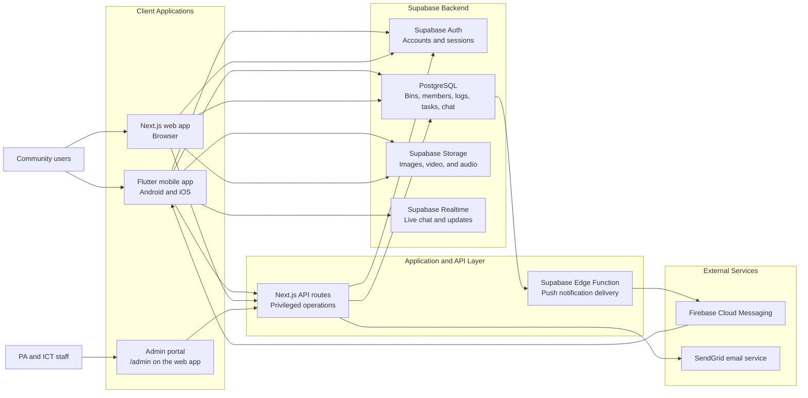
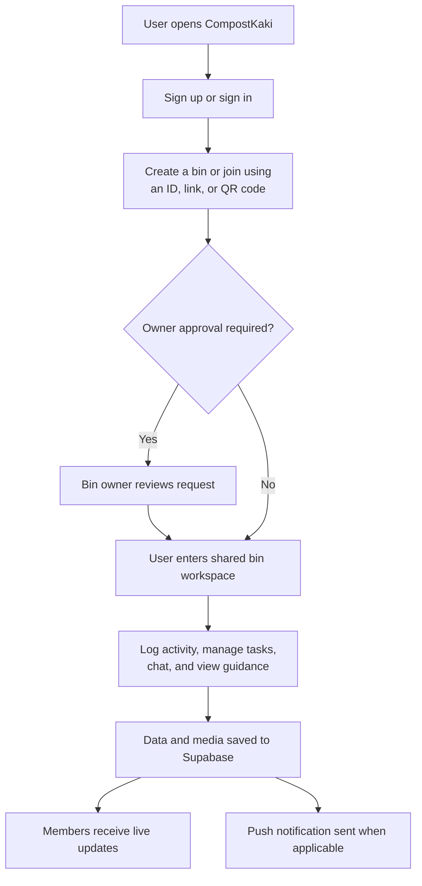
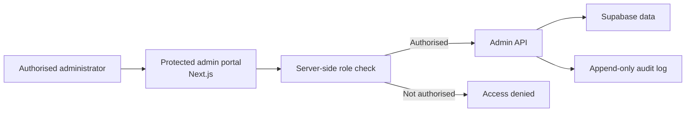
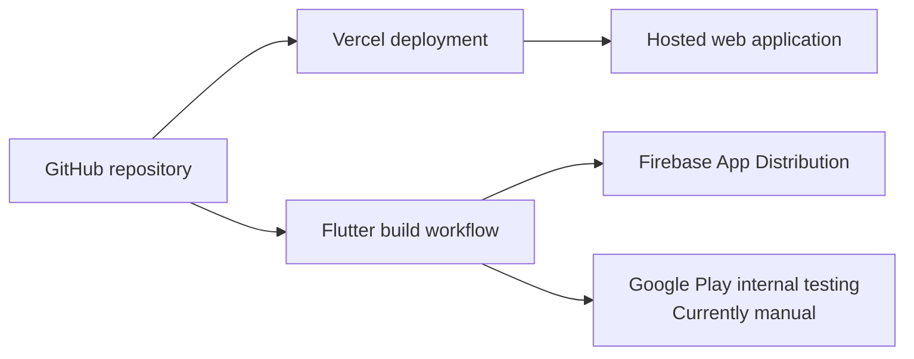

# CompostKaki System Architecture

**Document status:** Current-state overview, including the implemented admin portal  
**Prepared for:** People's Association (PA) and ICT stakeholders  
**Last updated:** 17 July 2026

## 1. Purpose

CompostKaki is a community composting platform that allows users to create or join shared compost bins, record composting activity, coordinate tasks, communicate with other members, and monitor progress.

The system currently includes:

- A Flutter mobile application for the main user experience
- A Next.js web application and server-side API routes
- Supabase for authentication, database, file storage, and real-time updates
- Firebase Cloud Messaging for mobile push notifications
- Vercel and Google/Firebase services for hosting and app distribution

## 2. High-Level Architecture



The admin portal is served from the web application at `/admin` and is restricted to users with an `admin` or `super_admin` role.

## 3. How the Application Works



### Typical user journey

1. The user creates an account or signs in using email and password.
2. The user creates a compost bin or joins an existing bin through its identifier, invitation link, or QR code.
3. Where approval is enabled, the bin owner accepts or rejects the join request.
4. Bin members can record activities such as adding materials, watering, monitoring, or turning the compost.
5. Members can coordinate tasks, communicate through bin chat, view guides, and track the bin's activity history.
6. Updates are stored centrally and made available to other authorised members.
7. Relevant events can generate in-app and mobile push notifications.

## 4. Main System Components

### Flutter mobile application

The mobile app provides the most complete user experience. It includes account access, profiles, bins, QR joining, activity logs, tasks, chat and media, notifications, educational guides, and progress features.

### Next.js web application and APIs

The web application provides browser-based functionality. Its server-side routes also handle operations that should not be performed directly by a mobile client, including parts of account deletion and the custom password-reset process.

### Supabase

Supabase is the central backend:

- **Authentication:** user accounts and sessions
- **PostgreSQL database:** profiles, bins, memberships, requests, activity logs, tasks, messages, notifications, and progress data
- **Storage:** avatars, bin images, activity images, and chat media
- **Realtime:** live updates for features such as chat and notifications
- **Row Level Security:** intended to restrict data access according to the signed-in user and bin membership

### Notifications and email

Firebase Cloud Messaging delivers push notifications to mobile devices through a Supabase Edge Function. SendGrid is used by the custom password-reset email flow.

## 5. Security and Access Model

- Regular users authenticate through Supabase and receive a time-limited session.
- The mobile and web clients use the public Supabase anonymous key; this key is not a password and must be protected by correctly configured database Row Level Security policies.
- Privileged server operations use secrets that remain on the server and must never be included in the mobile app, source control, or shared documentation.
- Bin owners currently have bin-level management rights, including member and join-request management.
- Platform-wide `admin` and `super_admin` roles gate the admin portal (see Section 6).
- Each administrator should use an individually assigned account. Shared passwords and service keys should not be exchanged through email or messaging.

## 6. Admin Portal

The admin portal is implemented as part of the existing Next.js application at `/admin` (for example, `https://compostkaki.vercel.app/admin`). The Flutter mobile app is not involved. It provides:

- An overview of user, bin, activity, and administrator statistics, including a bin-health breakdown
- Searchable, paginated views of all users and all bins
- User suspension and reactivation (enforced at the Supabase Auth level, so it applies to both the web and mobile apps)
- Super-admin-only assignment of user, admin, and super-admin roles by email
- Bin health-status changes and ownership transfer
- An append-only audit trail recording each administrative action

Permanent user and bin deletion is intentionally excluded from this release to reduce operational and data-loss risk.

### Roles and access

- `user` (default): regular app user; no portal access.
- `admin`: can view statistics, users, and bins; can suspend/reactivate users and manage bins.
- `super_admin`: everything an admin can do, plus assigning and removing roles.

Roles live in a dedicated `user_roles` table, and all admin actions are recorded in `admin_audit_logs`. Both tables have Row Level Security enabled with no policies, so only server-side API routes using the service-role key can access them. Every admin API independently verifies the caller's role before acting.

### Bootstrapping the first super admin

Roles can only be granted by an existing super admin, so the first one is set once directly in the database. The user must already have a registered CompostKaki account. In the Supabase SQL editor:

```sql
INSERT INTO user_roles (user_id, role)
SELECT id, 'super_admin' FROM auth.users WHERE email = 'you@example.com'
ON CONFLICT (user_id) DO UPDATE SET role = 'super_admin';
```

That person can then sign in at `/admin` and assign roles to others from the Users page.

### Implementation map

- Migration: [`supabase/migrations/20260717120000_admin_rbac.sql`](../supabase/migrations/20260717120000_admin_rbac.sql)
- Authorization and audit helpers: [`lib/adminAuth.ts`](../lib/adminAuth.ts), [`lib/adminClient.ts`](../lib/adminClient.ts)
- APIs: [`app/api/admin`](../app/api/admin) (`me`, `stats`, `users`, `users/[id]`, `roles`, `bins`, `bins/[id]`, `audit`)
- UI: [`app/admin`](../app/admin) and [`components/admin`](../components/admin)



## 7. Deployment and Operations



- The Next.js application is deployed on Vercel.
- Flutter checks and test-distribution workflows run through GitHub Actions.
- Firebase App Distribution is available for pre-release Android testing.
- Google Play internal testing currently requires manual Android App Bundle upload and tester management in Play Console.

## 8. Known Limitations

### Google Play testing

Google Play internal-track deployment is currently manual. Release signing and Android App Bundle generation are configured, but automated upload and track promotion are not yet implemented.

**Current workaround:** Build a signed Android App Bundle, upload it to the internal testing track in Play Console, and add testers there. Firebase App Distribution can be used for earlier test builds.

### Password reset

The password-reset feature has a known mobile session/deep-link issue. OTP verification can succeed, but the app may not correctly restore the reset session before updating the password.

**Current workaround:** An administrator or support contact may need to assist affected users until the corrected flow is released. Passwords and reset codes must not be requested or exchanged by staff.

## 9. Current Technical Risks and Follow-Up

- The repository does not contain a complete version-controlled copy of the production database schema and Row Level Security policies. These should be exported and maintained as migrations.
- The admin portal must enforce permissions both in server APIs and at the database level.
- Password-reset diagnostic logs must not contain plaintext OTP values.
- Access to GitHub, Supabase, Vercel, Firebase, and Play Console should use named accounts with the minimum required role.

## 10. Ownership and Handover

The technical handover should include:

1. GitHub repository access through an individual collaborator invitation
2. Named access to required hosting and backend services
3. Environment setup instructions without embedding secret values
4. Admin portal operating procedures
5. User and support guides
6. A process for revoking access when a team member leaves the project

